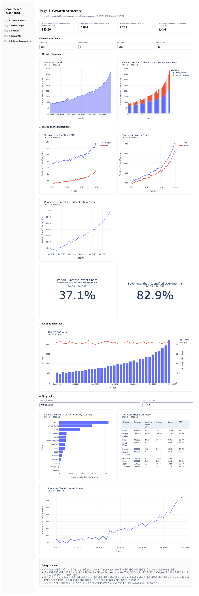
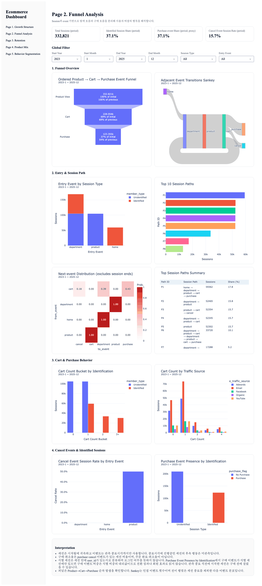
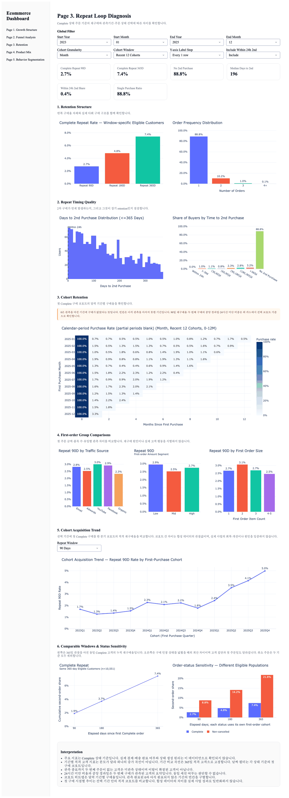
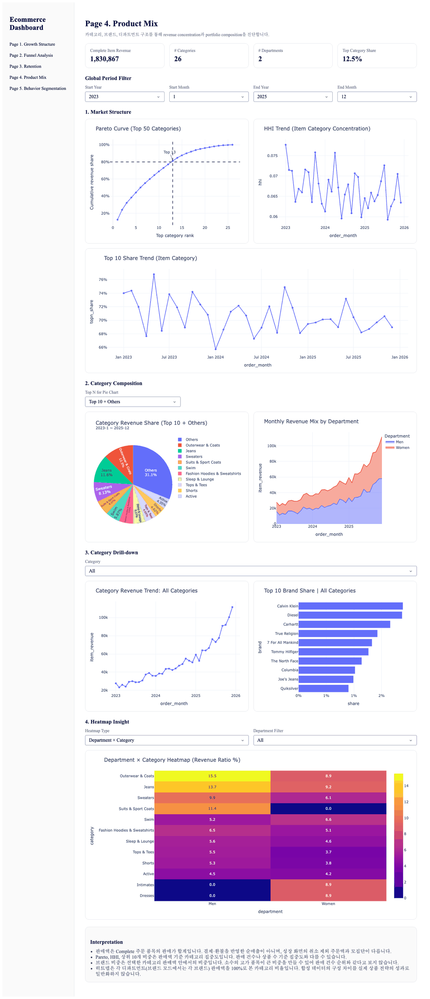
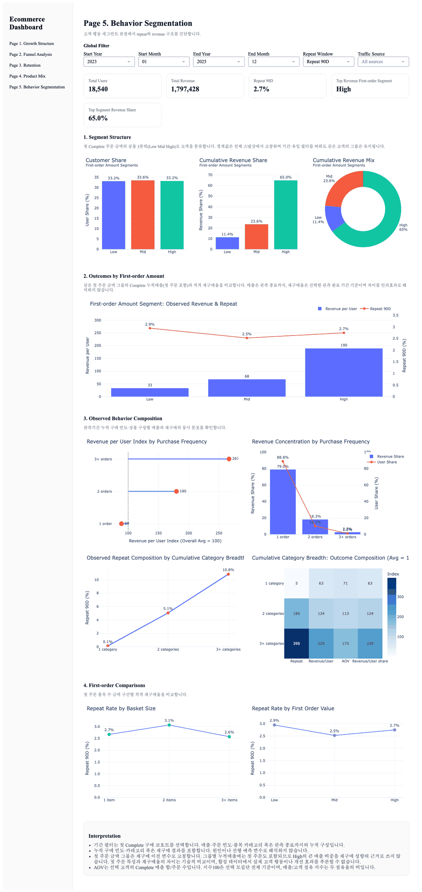

# 대시보드 페이지별 설명

[README로 돌아가기](README.md)

모든 화면은 기간 필터 기본값 2023-01 ~ 2025-12 상태이며, 기간 필터는 모든 차트·KPI에 똑같이 적용됨. 재구매·고객 화면의 기간은 첫 구매 시점 기준. 금액은 원본 판매가 합계이며 결제·환불을 반영한 순매출이 아님.

## Page 1. 성장 구조

*화면 설명: 상단 KPI 4개(2025-12 기준), 성장 개요·트래픽 진단·주문 효율·국가 구역의 차트와 표 9개.*

* **질문:** 주문액 변화는 주문 수와 객단가 중 어디서 오나?
* **KPI 카드:** 취소 제외 주문액 383,604 · 식별 MAU 5,024 · 구매자 4,235 · 취소 제외 주문 4,446 (2025-12 기준)

| 영역 | 차트 | 보는 것 |
|---|---|---|
| 성장 개요 | Revenue Trend · New vs Repeat Order Amount | 월별 취소 제외 주문액과 첫·반복 주문액 구성 |
| 트래픽·이벤트 진단 | Sessions vs Identified MAU · Traffic vs Buyers Trend · Purchase-event Share | 세션·식별 사용자·구매자 추이와 구매 이벤트 비중 |
| 주문 효율 | Orders and AOV | 월별 주문 수와 객단가 |
| 국가 | Order Amount by Country · Top Countries Summary · Revenue Trend: 선택 국가 | 국가 상위 N과 선택 국가의 추이 |

* **진단:** 월 주문 수는 1,076건(2023-01)에서 4,446건(2025-12)으로 늘었지만 월 객단가는 82.53–91.22 범위에 머물러 주문액 증가는 주문 수 증가와 함께 나타남.
* **지표 기준:** 주문액은 Cancelled를 제외한 Complete·Shipped·Processing·Returned 주문 기준. 식별 MAU는 user_id가 있는 이벤트 사용자 수. 구매 이벤트 비중은 식별 세션 비중과 같아 전환율로 쓰지 않음.

## Page 2. 세션 퍼널

*화면 설명: 상단 KPI 4개 아래로 퍼널과 Sankey, 진입 이벤트·세션 경로, 카트 횟수, 취소·식별별 차트가 배치됨. Top Session Paths Summary 표에 경로별 세션 수와 비중이 있음.*

* **질문:** 세션은 어떤 경로로 구매에 이르나?
* **KPI 카드:** 세션 332,821 · 식별 세션 비중 37.1% · 구매 이벤트 세션 비중 37.1% · 취소 이벤트 세션 비중 15.7%

| 영역 | 차트 | 보는 것 |
|---|---|---|
| 퍼널 개요 | Ordered Product → Cart → Purchase Event Funnel · Adjacent Event Transitions Sankey | 단계별 도달 세션과 인접 이벤트 간 이동 |
| 진입·경로 | Entry Event by Session Type · Top 10 Session Paths · Next-event Distribution · Top Session Paths Summary | 진입 이벤트, 자주 나온 경로, 다음 이벤트 분포 |
| 카트·구매 | Cart Count Bucket by Identification · Cart Count by Traffic Source | 식별 여부·유입 경로별 카트 담기 횟수 |
| 취소·식별 | Cancel Event Session Rate by Entry Event · Purchase Event Presence by Identification | 진입 이벤트별 취소 이벤트 비중, 식별 여부별 구매 이벤트 |

* **진단:** 식별 세션 비중과 구매 이벤트 세션 비중이 37.1%로 같고 구매 이벤트는 ID 있는 세션 123,355개에서만 나옴. 구매로 끝나는 경로는 home에서 시작한 P1(59,362개)과 department → product → cart를 반복하는 P6–P8(63,993개)뿐이며, 구매 이벤트 세션 중 비중은 48.12%·51.88%임.
* **지표 기준:** 세션은 시작 월에 넣고 관측 종료 시각까지의 이벤트만 사용. 구매·취소 비중은 해당 이벤트가 있는 세션 비율이며 주문 완료·취소율이 아님. Sankey는 인접 이벤트 이동 횟수.

## Page 3. 재구매

*화면 설명: 상단 KPI 6개, 재구매율 막대(90·180·365일, 기간별 분모), 재구매 시점 분포, 코호트 히트맵, 첫 주문 속성별 90일 재구매율, 코호트 추이, 같은 365일 고객 10,551명의 누적 재구매율 차트.*

* **질문:** 첫 구매 뒤 두 번째 구매는 얼마나, 언제 일어나나?
* **KPI 카드:** 90일 재구매율 2.7% · 365일 재구매율 7.4% · 두 번째 구매 없음 88.8% · 두 번째 구매까지 중앙값 196일 · 24시간 안 두 번째 구매 0.4% · 한 번만 구매 88.8%

| 영역 | 차트 | 보는 것 |
|---|---|---|
| 재구매율 | Complete Repeat Rate · Order Frequency Distribution | 90·180·365일 재구매율과 고객별 주문 횟수 |
| 재구매 시점 | Days to 2nd Purchase Distribution · Share of Buyers by Time to 2nd Purchase | 두 번째 구매까지 걸린 일수 |
| 코호트 | Calendar-period Purchase Rate · Cohort Acquisition Trend | 첫 구매 코호트별 기간 구매율과 90일 재구매율 추이 |
| 첫 주문 속성 | Repeat 90D by Traffic Source · First-order Amount Segment · First Order Size | 첫 주문의 유입·금액·품목 수별 90일 재구매율 |
| 같은 고객군 비교 | Complete Repeat (Same 365-day Eligible Customers) · Order-status Sensitivity | 같은 고객 10,551명의 누적 재구매율, 주문 상태 기준을 넓혔을 때의 차이 |

* **진단:** 같은 365일 관측 고객 10,551명의 누적 재구매율은 90·180·365일에 1.90%·3.71%·7.42%이고, 1년 내 재구매자 783명 중 583명(74.46%)이 90일 이후에 두 번째로 구매함.
* **지표 기준:** Complete 주문 기준. 90·180·365일 재구매율 2.74%·4.80%·7.42%는 각 기간을 다 관측한 고객(17,464명·14,766명·10,551명)이 분모라 하나의 증가 곡선이 아님. 두 번째 주문이 없는 고객은 아직 관측되지 않은 상태로, 이탈로 확정하지 않음. 기간 필터를 전체 기간으로 넓혀도(첫 구매 고객 27,469명) 1년 내 재구매자 중 90일 이후 비중은 75.05%로 결론이 같음.

## Page 4. 상품 구성

*화면 설명: 상단 KPI 4개, 파레토 곡선(상위 13개에서 80% 초과)·HHI·상위 10개 비중 추이, 카테고리 구성 파이와 부문별 판매액, 카테고리 추이·브랜드 Top 10, 부문×카테고리 히트맵.*

* **질문:** 판매액은 어느 카테고리와 브랜드에 모이나?
* **KPI 카드:** Complete 품목 판매액 1,830,867 · 카테고리 26개 · 디파트먼트 2개 · 1위 카테고리 비중 12.5%

| 영역 | 차트 | 보는 것 |
|---|---|---|
| 시장 구조 | Pareto Curve · HHI Trend · Top 10 Share Trend | 카테고리 누적 비중과 월별 집중도 |
| 카테고리 구성 | Category Revenue Share (Top 10 + Others) · Monthly Revenue Mix by Department | 상위 10개 카테고리 비중, 남성·여성 판매액 구성 |
| 카테고리 드릴다운 | Category Revenue Trend · Top 10 Brand Share | 선택 카테고리의 추이와 브랜드 비중 |
| 히트맵 | Department × Category Heatmap | 디파트먼트별 카테고리 판매액 비율 |

* **진단:** 1위 카테고리 비중은 12.47%이고 판매액 80%를 넘기려면 상위 13개 카테고리가 필요함(81.08%). 상위 10개 카테고리의 월별 비중은 65.73–76.79%. 카테고리를 Outerwear & Coats로 바꾸면 브랜드 판매액 비중은 The North Face 7.44%, Carhartt 7.05% 순.
* **지표 기준:** Complete 주문 품목의 판매가 합계. 브랜드 비중은 선택한 카테고리 판매액 안에서 차지하는 비중.

## Page 5. 고객 행동

*화면 설명: 상단 KPI 5개, 첫 주문 금액 3분위 고객 점유·누적 판매액 비중, 고객군별 판매액과 90일 재구매율(2.9%·2.5%·2.7%), 구매 빈도·카테고리 폭별 구성, 첫 주문 품목 수·금액별 재구매율.*

* **질문:** 첫 주문 금액으로 나눈 고객군은 이후 구매가 어떻게 다른가?
* **KPI 카드:** 고객 18,540명 · 누적 판매액 1,797,428 · 90일 재구매율 2.7% · 판매액 1위 고객군은 High 집단 · High 고객군 판매액 비중 65.0%

| 영역 | 차트 | 보는 것 |
|---|---|---|
| 고객군 구성 | Customer Share · Cumulative Revenue Share · Cumulative Revenue Mix | Low·Mid·High 고객군의 고객 수와 누적 판매액 비중 |
| 고객군 비교 | First-order Amount Segment: Observed Revenue & Repeat | 고객군별 누적 판매액과 90일 재구매율 |
| 구매 빈도·카테고리 폭 | Revenue per User Index · Revenue Concentration by Purchase Frequency · Observed Repeat Composition · Cumulative Category Breadth | 누적 구매 횟수와 구매한 카테고리 수별 판매액·재구매 구성 |
| 첫 주문 구간 | Repeat Rate by Basket Size · Repeat Rate by First Order Value | 첫 주문 품목 수·금액 구간별 재구매율 |

* **진단:** 90일 재구매율은 Low 2.95% · Mid 2.52% · High 2.75%로, 첫 주문 금액이 클수록 높아지지 않음.
* **지표 기준:** 고객군 경계는 전체 Complete 구매자 27,469명의 첫 주문 금액 3분위로 고정하고, 기간 필터는 그 안에서 첫 구매 시점으로 고객을 고름. 고객당 누적 판매액은 18,540명 전체, 90일 재구매율은 90일 관측을 마친 17,464명 기준. 누적 판매액에는 첫 주문이 포함되므로 High의 판매액 비중 65.0%를 재구매 성향으로 읽지 않음. 누적 구매 횟수·카테고리 폭은 재구매 결과를 포함하므로 원인으로 해석하지 않음. 전체 기간 첫 구매 고객으로 봐도 90일 재구매율은 2.20–2.53%로 첫 주문 금액과 함께 높아지지 않음.
