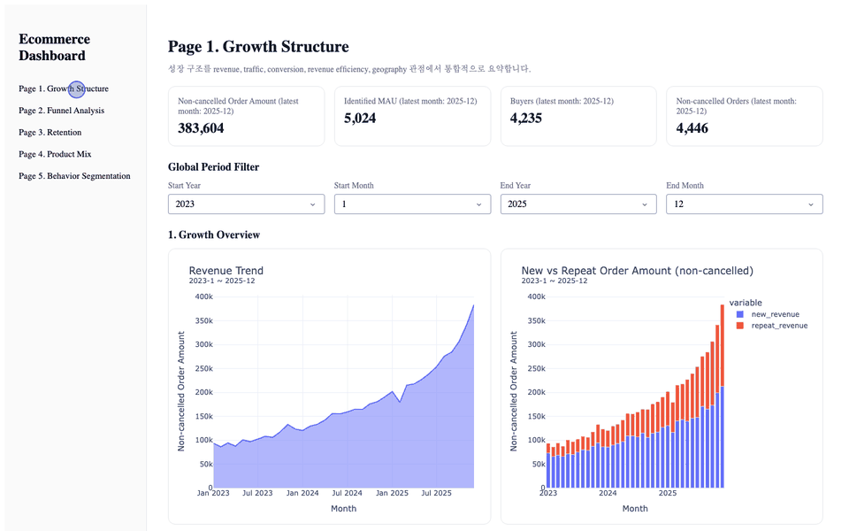
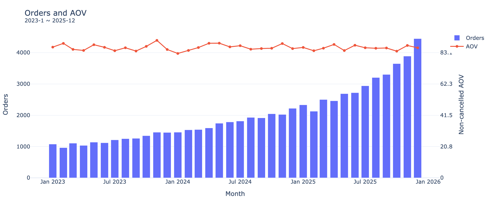
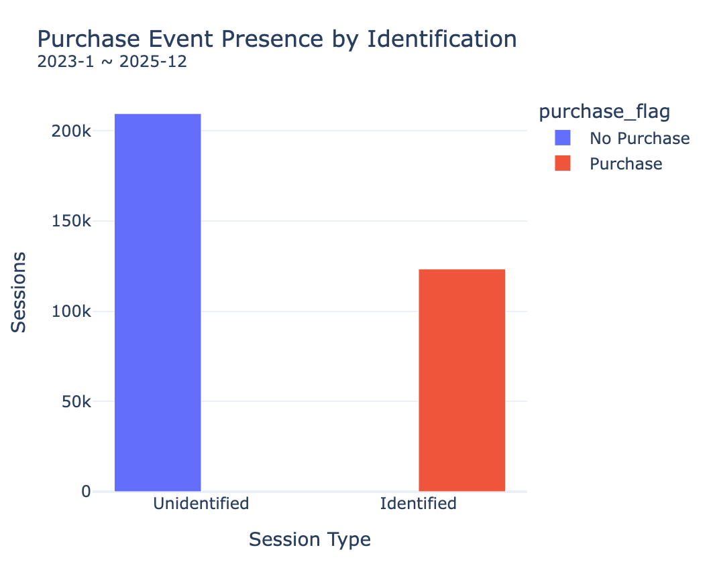
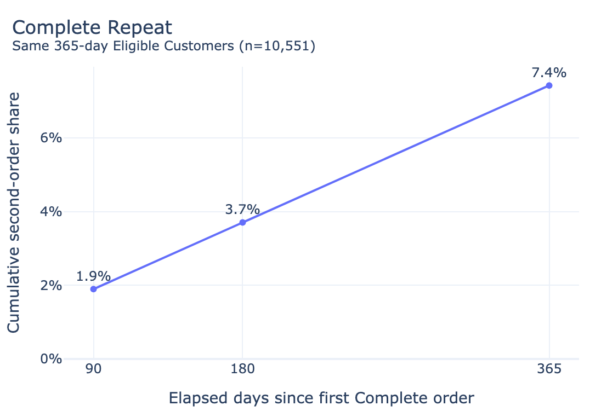
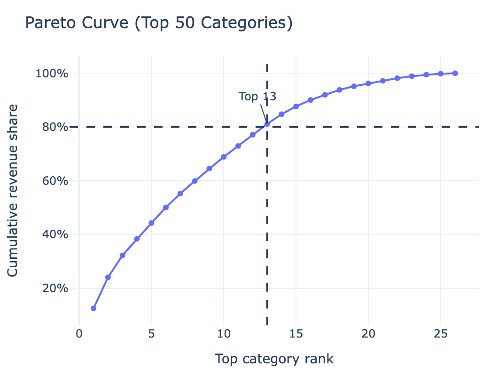
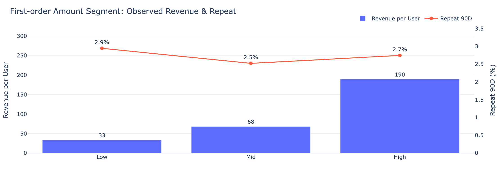

# 이커머스 행동 진단 대시보드

**스택:** BigQuery SQL · pandas-gbq · Parquet · Dash · Plotly · Flask · Flask-Login · SQLite<br>
**데이터:** [BigQuery 공개 theLook 이커머스 합성 데이터](https://console.cloud.google.com/marketplace/product/bigquery-public-data/thelook-ecommerce). 유저 100,000명, 관측 종료 2026-02-28 00:00 UTC 이전 이벤트 2,425,654건<br>
**제작:** 2026.01–03

## 프로젝트 배경

* 이커머스 고객 행동을 살펴보고자 EDA와 재구매 예측을 시도했으나, 반복 구매 기록이 제한적이고 재구매 간격이 긴 분포를 확인.
* 예측에 앞서 구매 구조를 파악하고자, 사업·그로스 담당자가 기간별 성장과 고객 행동을 함께 점검하는 진단 대시보드로 방향을 설정.
* SQL 집계부터 기간 필터를 갖춘 5개 화면과 회원가입·로그인까지 구현.



## 진단 결과

| 영역 | 비교 | 결과 | 대시보드 차트 |
|---|---|---:|---|
| 성장 | 월 취소 제외 주문 수 2023-01 → 2025-12 | 1,076 → 4,446건 | Page 1 Orders and AOV |
| 성장 | 같은 기간 월 객단가 | 86.73 → 86.28 | Page 1 Orders and AOV |
| 퍼널 | 구매 이벤트가 있는 세션 비율: ID 있음 / 없음 | 100% / 0% | Page 2 Purchase Event Presence by Identification |
| 재구매 | 같은 고객 10,551명의 90·180·365일 누적 재구매율 | 1.90% · 3.71% · 7.42% | Page 3 Complete Repeat (Same 365-day Eligible Customers) |
| 상품 | 1위 카테고리 비중 / 판매액 80%를 넘는 상위 카테고리 | 12.47% / 13개 | Page 4 Pareto Curve |
| 고객 | 첫 주문 금액 Low·Mid·High의 90일 재구매율 | 2.95% · 2.52% · 2.75% | Page 5 First-order Amount Segment |

대시보드 화면 값, 전 화면 2023-01 ~ 2025-12 기준(재구매·고객 화면은 이 기간에 첫 구매한 고객)

**주요 진단**

1. **주문액 증가는 주문 수 증가와 함께 나타남.** 월 객단가는 36개월 내내 82.53–91.22 범위 유지.



2. **구매는 고객 ID가 있는 세션에서만 기록됨.** ID 있는 세션 123,355개는 모두 구매 이벤트가 있고, ID 없는 세션 209,466개는 구매 이벤트 0건.



3. **90일 지표만 보면 1년 내 재구매 고객의 4분의 3을 놓침.** 같은 고객 10,551명 중 90일 내 재구매 고객은 200명, 365일까지는 783명.



4. **판매액은 특정 카테고리에 몰려 있지 않음.** 1위 카테고리 비중은 12.47%이고, 판매액 80%를 넘기려면 상위 13개 카테고리(81.08%)까지 필요.



5. **첫 주문 금액이 클수록 재구매가 높아지지는 않음.** 고객당 누적 판매액은 Low 33에서 High 190까지 벌어지지만 90일 재구매율은 2.52–2.95% 범위.



## 적용 아이디어

### 성장 · 반복 주문을 별도 목표로 관리

* **대시보드 진단:** 주문액은 늘었지만 **객단가는 그대로**(진단 1). Page 1 New vs Repeat Order Amount는 첫·반복 주문을 월별 금액으로만 보여 줌. 이에 늘어난 주문이 어느 쪽에서 왔는지 보기 위해 연도별 주문 건수를 첫 주문과 반복 주문으로 구분.

| 연도 | 취소 제외 주문 | 첫 주문 | 반복 주문 | 반복 주문 비중 |
|---|---:|---:|---:|---:|
| 2023 | 14,403 | 10,560 | 3,843 | 26.68% |
| 2024 | 21,589 | 14,701 | 6,888 | 31.91% |
| 2025 | 36,250 | 21,886 | 14,364 | 39.62% |

* **추가 분석:** 2023 → 2025년 **반복 주문은 3.7배, 첫 주문은 2.1배** 늘어 반복 주문 비중이 매년 높아짐. 첫·반복 주문의 건당 금액은 모두 86 안팎이라 금액 기준 비중과 건수 기준 비중의 차이는 0.3%p 미만.
* **제안:** **재구매 안내 발송 시점을 90일 이후 구간까지 나눠 A/B 테스트**. 1년 내 재구매 고객의 4분의 3이 이 구간에서 두 번째로 구매함(진단 3).
* **측정 방법:** 발송 시점별 **실험군과 미발송 대조군의 재구매율 차이**는 후속 분석으로 판정하고, 유입 경로·첫 주문 금액 고객군별로도 나눠 봄. 반복 주문 비중은 Page 1 New vs Repeat Order Amount로 매월 확인.

### 퍼널 · 구매 전 이탈을 볼 수 있게 로그 보강

* **대시보드 진단:** **구매는 ID 있는 세션에서만 기록됐고**(진단 2), Page 2 Top Session Paths Summary에서 구매로 끝나는 경로는 아래 두 유형뿐.

| 구매 경로 유형 | 세션 수 | 구매 이벤트 세션 중 비중 |
|---|---:|---:|
| home → department → product → cart → purchase (P1) | 59,362 | 48.12% |
| department → product → cart를 2·3·4회 반복 → purchase (P6–P8) | 63,993 | 51.88% |

* **추가 분석:** 이벤트 원본에서 세션별 ID는 첫 이벤트부터 끝까지 바뀌지 않았고 **purchase 이벤트에는 주문 ID가 없었음**. 비회원 이탈이나 결제 단계 문제는 이 로그로 확인 불가.
* **제안:** **로그인·가입 시점 이벤트와 purchase 이벤트의 주문 ID를 함께 수집**해 세션과 주문을 연결.
* **측정 방법:** 수집 후 purchase 이벤트가 실제 주문과 이어지는지 점검하고, **로그인 전후 이탈률과 세션별 주문 전환율**을 Page 2 KPI로 추가.

### 상품 · 브랜드를 판매액과 판매 건수로 함께 평가

* **대시보드 진단:** 카테고리 집중은 낮았음(진단 4). 1위 카테고리 Outerwear & Coats를 Page 4 브랜드 차트로 보면 The North Face 7.44%, Carhartt 7.05%로 **판매액 비중이 비슷한 수준**. 대시보드는 판매액 비중만 보여 주므로 판매 건수를 추가 집계.

| 아우터 브랜드 | 판매액 비중 | 판매 건수 | 판매 건수 비중 | 건당 평균 판매가 |
|---|---:|---:|---:|---:|
| The North Face | 7.44% | 36 | 2.34% | 471.49 |
| Carhartt | 7.05% | 129 | 8.38% | 124.79 |

* **추가 분석:** **판매 건수는 Carhartt가 The North Face의 3.6배**. The North Face 아우터 판매액의 74.48%는 판매가가 903으로 기록된 14건에서 나옴.
* **제안:** 브랜드 평가를 **판매액과 판매 건수 두 기준**으로 실험 적용 후, 소수 고가 품목 비중이 큰 브랜드는 가격대별로 따로 확인.
* **측정 방법:** Page 4 Top 10 Brand Share에 **판매 건수 기준과 건당 평균 판매가**를 추가.

## 대시보드 구성

[페이지별 상세 설명: 화면 캡처·차트·지표 기준](DETAILS.md)

| 화면 | 질문 | 주요 그래프 |
|---|---|---|
| 1. 성장 | 주문액 변화는 주문 수와 객단가 중 어디서 오나 | 월별 주문액·주문 수·객단가, 첫·반복 주문, 국가 상위 N |
| 2. 세션 퍼널 | 세션은 어떤 경로로 구매에 이르나 | 단계 도달, Sankey 경로, 진입 이벤트별 비교 |
| 3. 재구매 | 두 번째 구매는 얼마나, 언제 일어나나 | 90·180·365일 재구매율, 소요시간 분포, 코호트 |
| 4. 상품 | 판매액은 어디에 모이나 | 파레토, 월별 HHI, 카테고리별 브랜드 |
| 5. 고객 | 첫 주문 금액별 고객군은 어떻게 다른가 | 3분위 고객군의 재구매·누적 판매액 |

## 데이터 처리

`theLook 원본 6개 테이블 → BigQuery SQL 집계 → Parquet 12종 → Python 통합 로딩 → Dash 5개 화면`

* BigQuery SQL로 원본을 살펴보고 세션·주문·고객·품목 단위 테이블을 따로 만들어 지표마다 집계 단위를 분리함.

## 주의사항

* 재구매율은 분모가 두 가지로 Page 3의 90일 재구매율 2.74%(카드 표시 2.7%)는 90일 관측 완료 17,464명 기준이고 위 표의 1.90%는 365일 관측 완료 10,551명 기준.

## 실행 방법

환경: Python 3.12. 로컬 세션 키는 자동 생성되며 재시작 후에도 세션을 유지하려면 `FLASK_SECRET_KEY` 환경변수 설정.

준비: theLook 원본 6개 테이블(orders·order_items·users·products·events·distribution_centers)을 자신의 BigQuery `data_mart` 데이터셋에 복사. 아래 `BQ_PROJECT`를 자신의 프로젝트 ID로 설정.

```bash
pip install -r code/app/requirements.txt
gcloud auth application-default login

# BigQuery SQL 실행 → code/app/data/parquet/에 Parquet 저장
export BQ_PROJECT="your-project-id"
cd code/pipeline
python run_sql.py
python export_parquet.py

# 적용 아이디어 추가 분석 표 → code/ideas/tables/
python ../ideas/analyze_ideas.py

# 대시보드 실행 → http://127.0.0.1:8888 (회원가입 후 로그인)
cd ../app
python app.py
```

[SQL](code/sql/) · [화면 코드](code/app/dashboard/pages/) · [적용 아이디어 분석](code/ideas/analyze_ideas.ipynb)
